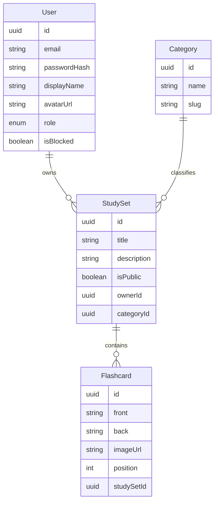

# TÀI LIỆU MÔ TẢ DỰ ÁN

## FLASHLEARN – NỀN TẢNG HỌC TẬP BẰNG FLASHCARD

| Thông tin | Giá trị |
|-----------|---------|
| Môn học | Lập trình Web |
| Nhóm | [Tên nhóm] |
| Số thành viên | 5 |
| Giảng viên | [Tên giảng viên] |
| Lớp | [Tên lớp] |
| Ngày | [Ngày/tháng/năm] |
| Version | 2.0 |

---

## 1. GIỚI THIỆU DỰ ÁN

### 1.1. Tên dự án

**FlashLearn** – Online Flashcard Learning Platform

### 1.2. Giới thiệu

FlashLearn là nền tảng học tập trực tuyến cho phép người dùng **tạo, quản lý, chia sẻ và học** thông qua các bộ Flashcard (Study Set).

Người dùng tạo Study Set chứa các thẻ (mặt trước / mặt sau), công khai hoặc riêng tư, và học bằng chế độ **lật thẻ** (flip). Hệ thống có trang quản trị để Admin quản lý người dùng, Study Set và danh mục.

> **Phạm vi MVP:** quản lý Study Set + Flashcard + Learn (flip). Không gồm Quiz, chấm điểm hay lịch sử quiz.

---

## 2. LÝ DO CHỌN ĐỀ TÀI

Flashcard phổ biến để ghi nhớ kiến thức (ngoại ngữ, lập trình, chuyên ngành, ôn thi). Công cụ giấy hoặc ghi chú đơn giản hạn chế về:

- Quản lý số lượng lớn Flashcard
- Tổ chức theo bộ (Study Set) và danh mục
- Chia sẻ nội dung công khai
- Học trực tuyến có cấu trúc

FlashLearn cung cấp nền tảng đơn giản, dễ dùng, tập trung vào quản lý nội dung và học bằng lật thẻ.

---

## 3. MỤC TIÊU DỰ ÁN

### 3.1. Mục tiêu chính

1. Đăng ký và quản lý tài khoản
2. Tạo và quản lý Study Set + Flashcard
3. Học Flashcard trực tuyến (flip)
4. Tìm kiếm / khám phá Study Set công khai
5. Quản lý hệ thống qua Admin (User, Study Set, Category)

### 3.2. Mục tiêu học tập

- HTML/CSS/JavaScript (React)
- Backend development (NestJS)
- Database (PostgreSQL + Prisma)
- Authentication & Authorization (JWT, RBAC)
- CRUD, REST API, Git, Docker

---

## 4. PHẠM VI DỰ ÁN

### Trong phạm vi (In scope)

**Người dùng**

- Register, Login, Logout, Profile
- Create / Edit / Delete Study Set
- Create / Edit / Delete / Reorder Flashcard
- Public / Private Study Set
- Explore Study Set công khai
- Learn Flashcard (flip, next/prev, shuffle)

**Admin**

- User Management (list, block/unblock)
- Study Set Management
- Category Management

### Ngoài phạm vi (Out of scope)

- Quiz / kiểm tra trắc nghiệm
- Chấm điểm, lịch sử học, rating thẻ, spaced repetition
- Upload file thật (avatar/image dùng URL)
- OAuth, Redis, realtime, mobile app

---

## 5. ĐỐI TƯỢNG SỬ DỤNG

### 5.1. Guest

- Xem trang chủ, Explore Study Set công khai
- Đăng ký / Đăng nhập

### 5.2. User / Student

- Quản lý tài khoản (profile)
- Tạo và quản lý Study Set + Flashcard của mình
- Học Flashcard
- Xem Study Set công khai của người khác

### 5.3. Admin

- Quản lý User (block/unblock)
- Quản lý mọi Study Set
- Quản lý Category

---

## 6. CÁC CHỨC NĂNG CHÍNH

### 6.1. Authentication

- Register, Login, Logout (client xóa JWT)

### 6.2. User Profile

- View / Update Profile
- Avatar qua URL (MVP)

### 6.3. Study Set

Tập hợp Flashcard. Ví dụ:

```
JavaScript Fundamentals
├── What is Promise?
├── What is Closure?
├── What is Event Loop?
└── What is Hoisting?
```

Chức năng: Create, View, Update, Delete, Public/Private, gắn Category

### 6.4. Flashcard

| Trường | Mô tả |
|--------|--------|
| Front | Mặt trước (câu hỏi / thuật ngữ) |
| Back | Mặt sau (đáp án / định nghĩa) |
| Image URL | Tùy chọn |
| Position | Thứ tự trong set |

Chức năng: Add, Edit, Delete, Reorder, Shuffle (khi học)

### 6.5. Learning

```
Start Learning → Show Front → Flip → Show Back → Next/Prev → Finish
```

Hỗ trợ Shuffle. Không có User Rating / Quiz.

### 6.6. Category

Danh mục phân loại Study Set (ví dụ: Ngôn ngữ, Lập trình). User chọn khi tạo set; Admin CRUD.

### 6.7. Admin

- Quản lý User, Block/Unblock
- Quản lý Study Set
- Quản lý Category

---

## 7. USER FLOW

### 7.1. Learning Flow

```
Login → Dashboard → Explore / My Sets → Select Study Set → Start Learning
  → Show Front → Flip → Show Back → Next Card → Finish
```

### 7.2. Create Study Set Flow

```
Login → Create Study Set → Thêm Flashcard (front/back) → Lưu → Detail / Learn
```

### 7.3. Admin Flow

```
Admin Login → Admin Dashboard → Users | Study Sets | Categories
```

---

## 8. SYSTEM ARCHITECTURE

```
WEB BROWSER
    │
    ▼
React Frontend (SPA)
    │  REST API + JWT Bearer
    ▼
NestJS Backend
    │
    ▼
PostgreSQL
```

Chi tiết schema: [DATABASE.md](./DATABASE.md)  
Chi tiết API: [API.md](./API.md)

---

## 9. TECHNOLOGY STACK

### Frontend

| Technology | Purpose |
|------------|---------|
| React + TypeScript | UI |
| React Router | Routing |
| Tailwind CSS | Styling |
| Axios | HTTP client |

### Backend

| Technology | Purpose |
|------------|---------|
| NestJS | API framework |
| TypeScript | Language |
| JWT | Authentication |
| Prisma | ORM |
| class-validator | DTO validation |

### Database & DevOps

| Technology | Purpose |
|------------|---------|
| PostgreSQL | Database |
| Docker Compose | Local Postgres |
| dotenv | Env config |

---

## 10. DATABASE DESIGN

Entities: **User**, **Category**, **StudySet**, **Flashcard**.



Quy tắc:

- User chỉ CRUD Study Set / Flashcard của mình
- Guest và User đọc được set `isPublic = true`
- User `isBlocked` không đăng nhập được
- Admin quản lý User, mọi Study Set, Category

---

## 11. API DESIGN

REST, prefix `/api`. Chi tiết đầy đủ: [API.md](./API.md).

Tóm tắt:

- `POST /auth/register`, `POST /auth/login`
- `GET/PUT /users/me`
- `GET/POST /study-sets`, `GET/PUT/DELETE /study-sets/:id`
- `GET/POST /study-sets/:id/cards`, `PUT/DELETE /flashcards/:id`, `PUT .../cards/reorder`
- `GET /categories` (+ Admin CRUD)
- Admin: users, study-sets, categories

---

## 12. GIAO DIỆN DỰ KIẾN

### Public

Home, Login, Register, Explore

### User

Dashboard, My Study Sets, Create/Edit Study Set, Study Set Detail, Learn, Profile

### Admin

Admin Dashboard, User Management, Study Set Management, Category Management

---

## 13. TESTING

### Functional

Register, Login, CRUD Study Set/Flashcard, Learn, Admin

### Validation

Email không hợp lệ, email trùng, mật khẩu yếu, thiếu field, ID sai, unauthorized

### Authorization

- User không gọi Admin API
- User chỉ sửa Study Set của mình
- Guest không đọc private Study Set
- Admin có quyền quản trị

---

## 14. SECURITY

- Password hashing (bcrypt)
- JWT Authentication
- Role-based Authorization
- Input Validation (DTO)
- Ownership checks trên mutate
- CORS
- Secrets qua biến môi trường (không hard-code)

---

## 15. KẾT QUẢ DỰ KIẾN

1. Đăng ký / đăng nhập
2. Quản lý Study Set
3. Quản lý Flashcard
4. Học bằng lật thẻ
5. Admin quản lý User / Study Set / Category

---

## 16. KẾT LUẬN

FlashLearn tập trung vào **quản lý nội dung Flashcard** và **học bằng lật thẻ**, kèm quản trị cơ bản. Dự án giúp nhóm áp dụng Frontend, Backend, Database, REST API, Authentication, Authorization, Git và Deployment vào một sản phẩm Web hoàn chỉnh.

**END OF DOCUMENT**
